# Parcel damage inspection

Jimena Navarro del Águila — Assignment 2. 

The project supports a warehouse decision: pass an inspection image, hold visible damage, or send an uncertain image to a person. Jimena chose parcel damage and requested a feedback loop on 25 October 2026. Business and cost inputs are documented in `BUSINESS_INPUTS.md`; sourced benchmarks are distinguished from assumptions.

## Run

Use Python 3.12 and the dependencies in `pyproject.toml`:

```bash
uv run python main.py train
uv run python main.py app
uv run python check.py
```

Add `ROBOFLOW_API_KEY` privately to `.env`. The credential is used only for the public Roboflow download; it is not copied into results or archives. The public dataset is `recog-ayum6 / boxes_status / 2`, downloaded as supplied without forking, reshuffling or relabelling.

The app loads `weights/best.pt` and saved outputs. It never trains at startup and runs locally without a public sharing link. The trained weights and real evaluation artifacts must exist before the app can start. A missing key or missing model is reported clearly rather than replaced with fabricated results.

## Feedback architecture

```mermaid
flowchart LR
 A[Public training split] --> B[YOLO11n fine tuning]
 B --> C[Validation observer]
 C --> D[Critic identifies actual misses and false holds]
 D --> E[Planner proposes one bounded higher resolution repair]
 E --> F[Train separate candidate on the same public training split]
 F --> G[Compare validation cost and damage recall]
 G -->|Improves cost without lower recall| H[Select candidate for coursework evaluation]
 G -->|Fails gate| I[Retain original model]
 H --> J[Evaluate frozen selection on held out test split]
 I --> J
 J --> K[Local dashboard]
 K --> L[Human verified feedback]
 L --> M[Separate local error audit and repair plan]
 M --> N[Fresh independent audit and approval before operational promotion]
```



The automatic offline repair cycle is bounded to one candidate. Its hypothesis is explicit: higher input resolution and additional fine-tuning may help recover missed evidence. The candidate is not assumed to be better. Its validation scores decide whether it is retained, and that decision is logged in `artifacts/offline-feedback-cycle.json`. No test scores are used to choose the model or thresholds.

New uploaded images and human labels are stored under `feedback/private/`, excluded from source control and submission archives. They do not silently enter the coursework dataset. Online diagnostic agents flag possible acquisition or class-definition issues as hypotheses, not proven root causes. A missing recognised box triggers human review rather than an automatic pass.

The operational promotion gate requires a fresh independent audit, improved cost, no reduction in damage recall, feasible review demand and a recorded approval. It returns a decision and preserves a rollback hash; it does not overwrite deployed weights on the strength of its own predictions.

## Evaluation units

Detection quality is measured per labelled object, with per-class precision, recall, AP50, mAP50–95 and a background-aware confusion matrix. The business decision is image-level: an image is positive if any labelled object has `box_damaged`. Those units must not be conflated.

The COCO model is executed as a zero-shot baseline and mapped by exact class name. Its class indices are never reused as parcel labels. COCO has none of this dataset's three classes, so zero target detections is an honest baseline result rather than an open-vocabulary detector. A separate predict-nothing baseline is also included.

The cost calculations reweight class-conditional results to an explicit production prevalence. Human accuracy, review time, volume and cost are assumptions exposed for sensitivity analysis. Thresholds are selected on validation data and evaluated once on the held-out test data. A staffing failure is reported rather than hidden by selecting a policy that needs more people than assumed.

## Status and disclosure

AI assisted the technical implementation, research and report wording. Jimena supplied the problem and feedback-loop direction. Unit-test fixtures are synthetic arithmetic checks, not model results.

Before submitting: run real training and `check.py`, review the measured findings, complete `REPORT.md`, include trained weights, prepare the required PR and repository ZIP, then submit only when Jimena authorises it. Do not include `.env`, downloaded datasets, private feedback or local environment directories in the ZIP.
