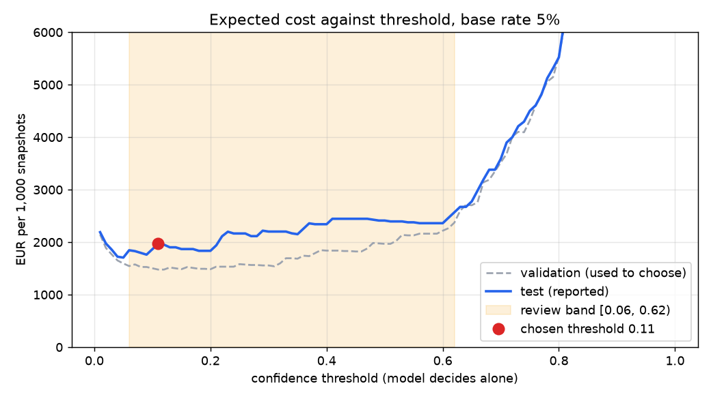
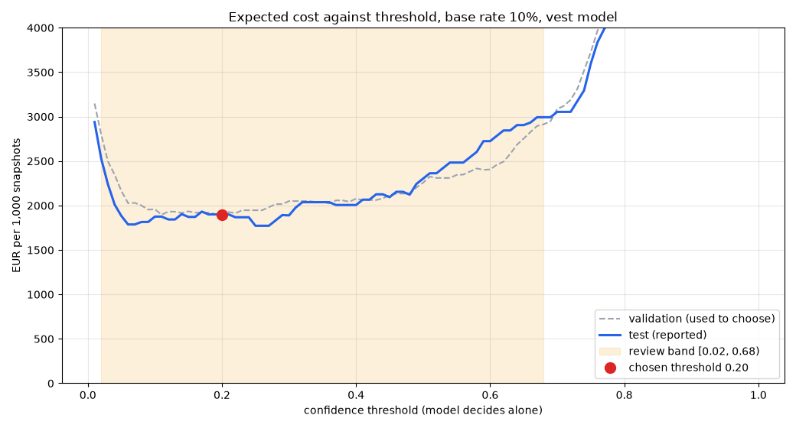

# Assignment 2 Report

- **Name**: Lucas Agustin Vucinovich
- **Student ID**: 18140
- **Email**: lvucinovich.ieu2022@student.ie.edu
- **Group**: BBADBA 5A

## Business problem, and the cost of being wrong

**The decision:** for each camera snapshot of a work zone, is someone working
without a hard hat, and do we send the foreman?

- **Who acts on it:** the site foreman or safety officer. Today they walk around
  and look, so a worker without a hat can go unnoticed for hours.
- **Setup I assume:** 10 fixed cameras, one snapshot every 5 min, 10-hour shift,
  so **1,200 snapshots/day**.
- **Three outcomes per snapshot:** pass, human review, or fail (the foreman goes
  to the zone).
- **Positive class:** at least one worker without a hard hat.
- **Second check, safety vests:** the same question for high-visibility vests,
  answered by a **second, separate model** (see "Adding vests"). The hard hat
  model is the main one. Most of this report is about it, and the vest model
  follows the same method.

**Why the two errors cost different amounts:**

- **False negative (missed violation), the expensive one:**
  - a worker stays unprotected until the next check;
  - risk of a labour inspection fine (a serious infraction under the Spanish
    LISOS, from 2,451 EUR);
  - risk of a head injury (lost days, insurance surcharge, liability, hundreds of
    thousands of EUR).
- **False positive (false alarm), the cheap one:** the foreman walks over for
  nothing, about 10 min, around 10 EUR.
- **A miss is about 30x worse than a false alarm** (300 EUR vs 10 EUR).

**What this drives later:**

- the metric I care about most is **recall on `head`**;
- the threshold should be **low**;
- unsure cases go to a person instead of being passed.

## Dataset

- **Roboflow Universe:** workspace `joseph-nelson`, project `hard-hat-workers`,
  **version 10**.
- **Link:** https://universe.roboflow.com/joseph-nelson/hard-hat-workers/dataset/10
- **License:** Public Domain. **Task:** object detection.
- **One image:** a photo of one or more people, mostly on construction sites,
  with a box on every head.
- **Classes:**
  - `head`: a head **without** a hard hat (my positive class)
  - `helmet`: a head **with** a hard hat
  - `person`: a full body (barely labelled, see below)

**Why it fits the problem:**

- The label is exactly what the foreman checks: not "is there a worker" but "is
  this head protected".
- The negative (`helmet`) is labelled too, so the model learns to tell hat from
  no hat, not just to find people.

**Why version 10:**

- **v14** (the latest) merges all classes into one `head` class, which is useless
  for me.
- **v11 to v13** are augmented copies (16,867 images). I would rather control
  augmentation myself.
- **v10** is the 7,035 raw images, only auto-oriented.

**Vest dataset (second model):**

- **Roboflow Universe:** workspace `roboflow-universe-projects`, project
  `safety-vests`, **version 1**.
- **Link:** https://universe.roboflow.com/roboflow-universe-projects/safety-vests/dataset/1
- **License:** CC BY 4.0. **Task:** object detection, 3,897 images.
- **Classes:** `NO-Safety Vest` (my positive class) and `Safety Vest`, one box
  per torso.
- **Why this one:**
  - my first choice (`new-ja4hn/ppe-detection`, hats and vests together) has no
    published version, so it can't be downloaded;
  - other vest sets had about 200 `no-vest` boxes. This one has **2,024**, with
    a proper train/valid/test split.
- **Why not one model for both:** the two datasets don't label each other's
  classes. The vest images have bare heads with no `head` box, and the hat
  images have vests with no vest box. Training one model on both would teach it
  that those are background. Two models keep the hard hat model untouched and
  cost one extra inference (about 5 ms).

## What the dataset's composition implies

| Split | Images | `head` | `helmet` | `person` | Images with a `head` |
|---|---|---|---|---|---|
| train | 4,916 | 4,612 | 13,919 | 450 | 911 (18.5%) |
| valid | 1,413 | 1,339 | 3,913 | 101 | 256 (18.1%) |
| test | 706 | 726 | 1,915 | 64 | 140 (19.8%) |

**Object size** (box area / image area):

- `head` median **0.6%**, `helmet` 0.8%, `person` 6 to 8%
- **about 30% of heads are under 0.4% of the image**, roughly 25 px wide in
  500x333 photos

**What I take from this:**

- **`head` and `helmet` are trustworthy.** There are 726 and 1,915 test
  instances, so recall has a margin of error of 1 to 2 points.
- **`person` is not.** It appears in only 23 test images and is labelled
  inconsistently. Any number for it is noise, and the decision doesn't use it.
- **Imbalance:** there are 3 helmets per head, so the overall average can hide a
  weak `head` class. That is why I report per class.
- **Small heads will be the hard part.** Confirmed below.
- **The test split doesn't look like production:**
  - news and web photos at eye level, in daylight;
  - real cameras are high up, angled down, and work in rain and at dusk;
  - 20% of test images contain a violation, while a real site should have far
    fewer.
  - So the test numbers are optimistic, and **the test share is not my base
    rate.** I re-weight to an assumed 5%.
- **Labels are noisy.** Some red hard hats are labelled `head`, and some bare
  heads aren't labelled. Part of my "errors" are labelling errors (see the
  failures section).

**Vest dataset:**

| Split | Images | `NO-Safety Vest` | `Safety Vest` | Images with a `NO-Safety Vest` |
|---|---|---|---|---|
| train | 2,728 | 1,436 | 4,499 | 678 (24.9%) |
| valid | 779 | 362 | 1,287 | 189 (24.3%) |
| test | 390 | 226 | 662 | 108 (27.7%) |

- **Much less to learn from:** 1,436 `no-vest` boxes in train against 4,612
  `head` boxes, about **3x fewer**.
- **Much less to test on:** 226 test instances in 108 images. Recall has a
  margin of error of about **±4 points** (against ±1.4 for `head`).
- **Bigger objects:** a torso is a median 4 to 6% of the image, so size is less
  of a problem than with heads.
- **Mixed sources:** images from 416 px to 1,600 px wide, many stock photos
  with watermarks. Further from a site camera than the hard hat set.

## Finetuning and baselines

**Model:** `yolo11s` detection, finetuned from the COCO checkpoint.

- **Detection, not classification:** one bare head among ten helmets is still a
  violation, so I need to look at every head.
- **`s` rather than `n`:** a third of the heads are tiny, and the bigger model
  handles small objects better. It still runs at 5.5 ms per image.

**Training:**

- my laptop, NVIDIA RTX 4060 Laptop GPU (8 GB);
- 50 epochs, image size 640, batch 16, AdamW (auto, lr0 0.00143), seed 0,
  patience 15 (never triggered), 2 workers;
- **1.93 hours** for hard hats, **0.77 hours** for vests (same settings);
- with 4 workers the laptop ran out of RAM twice, so I dropped to 2 and trained
  from scratch;
- best epoch (validation fitness) saved as `weights/helmet.pt` and
  `weights/vest.pt`.

**Baselines (same 706 test images):**

- **COCO `yolo11s` zero-shot.** COCO has `person` but no hat or head class. I
  scored its person boxes as each class to give it the best chance. At snapshot
  level its best guess is "there is a person".
- **Predict nothing.** It never alarms, the same as no system.

| Model | mAP50 | mAP50-95 | `head` AP50 | `helmet` AP50 | EUR / 1,000 snapshots (alone) |
|---|---|---|---|---|---|
| **Finetuned yolo11s** | **0.653** | **0.458** | **0.955** | **0.983** | **1,969** |
| COCO zero-shot | 0.015 | 0.009 | 0.003 | 0.005 | 8,952 |
| Predict nothing | 0.000 | 0.000 | 0.000 | 0.000 | 15,000 |

(Cost uses each model's best threshold on validation, the cost matrix and a 5%
base rate.)

**Takeaways:**

- The finetuned model **beats both baselines by far.**
- COCO can't tell a hat from a head, so it flags every person:
  - it catches 89% of violations;
  - but it false-alarms on **73%** of clean snapshots, almost as costly as doing
    nothing.
- An mAP50 of 0.653 looks low only because `person` drags it down. On the two
  classes that matter it is **0.96 to 0.98**.

**Vest model, same baselines (390 test images, 10% base rate):**

| Model | mAP50 | mAP50-95 | `NO-Safety Vest` AP50 | `Safety Vest` AP50 | EUR / 1,000 snapshots (alone) |
|---|---|---|---|---|---|
| **Finetuned yolo11s** | **0.893** | **0.555** | **0.864** | **0.921** | **1,900** |
| COCO zero-shot | 0.034 | 0.007 | 0.020 | 0.048 | 7,586 |
| Predict nothing | 0.000 | 0.000 | 0.000 | 0.000 | 7,500 |

- Again far better than both baselines. COCO is even worse than doing nothing.
- **Careful:** the vest mAP50 (0.893) is higher than the hard hat one (0.653)
  only because the vest set has no useless `person` class. On the class that
  matters the vest model is **worse** (0.864 vs 0.955). See "Why the vest model
  is weaker".

## Per-class evaluation and failure modes

**Finetuned model on test** (precision and recall at my threshold, 0.11):

| Class | Instances | AP50 | AP50-95 | Precision | Recall |
|---|---|---|---|---|---|
| **`head` (positive)** | 726 | 0.955 | 0.674 | 0.852 | **0.960** |
| `helmet` | 1,915 | 0.983 | 0.687 | 0.881 | 0.975 |
| `person` | 64 | 0.023 | 0.013 | 0.000 | 0.000 |

**Confusion matrix** (conf ≥ 0.11, IoU ≥ 0.5, rows = truth):

| true \ predicted | head | helmet | person | missed |
|---|---|---|---|---|
| **head** | **695** | 14 | 0 | 17 |
| **helmet** | 4 | 1,866 | 0 | 45 |
| **person** | 0 | 0 | 0 | 64 |
| **background** | 119 | 241 | 55 | – |

**What carries the headline and what drags it:**

- **Carries it:** `head` (0.955) and `helmet` (0.983).
- **Drags it:** `person` (0.02). Most people in training aren't boxed as
  `person`, so the model learned to ignore it. It's a labelling problem and
  doesn't affect my decision.

**Where it fails:**

- **Head vs helmet is rarely confused:** 14 of 726 heads called helmet (2%), 4
  helmets called head.
- **The real errors are against the background:**
  - 17 heads missed;
  - 119 `head` boxes where nothing is labelled, so precision is 0.85 while
    recall is 0.96. At a low threshold that's the trade I want, because false
    alarms are cheap.
- **Small heads are missed more** (`head` recall):
  - small (<0.4% of image): **0.935** (200 instances)
  - medium: 0.968 (468)
  - large: 0.983 (58)

**What the worst failures actually are** (also in the dashboard gallery):

- **Worst "miss" (score 0.00):** the boxes labelled `head` are on people wearing
  **red hard hats**. The model is right and the label is wrong.
- **Another miss:** a man in a **cowboy hat**, from behind. The model takes any
  hat for a hard hat, a real weakness since caps are common on sites.
- **Worst "false alarms" (0.67 to 0.87):** clearly bare heads that **aren't
  labelled** (villagers, a crowd, a young man next to a fire officer). On a real
  site a visitor without a hat is a violation too.
- **So:** the measured errors mix model mistakes with label mistakes. The costs
  are a bit pessimistic about the model, while real cameras would push the
  other way.

**Vest model on test** (at its threshold, 0.20):

| Class | Instances | AP50 | AP50-95 | Precision | Recall |
|---|---|---|---|---|---|
| **`NO-Safety Vest` (positive)** | 226 | 0.864 | 0.467 | 0.806 | **0.885** |
| `Safety Vest` | 662 | 0.921 | 0.642 | 0.806 | 0.899 |

| true \ predicted | no vest | vest | missed |
|---|---|---|---|
| **no vest** | **198** | 7 | 21 |
| **vest** | 11 | 595 | 56 |
| **background** | 39 | 136 | – |

- **Vest vs no vest is rarely confused** (7 and 11). Like hats, the errors are
  against the background: 21 violations missed, 39 extra `no-vest` boxes.
- **Size matters less:** `no-vest` recall 0.86 small (<2%, 64), 0.90 medium
  (103), 0.88 large (59).
- **The worst failures are mostly label problems again:**
  - **both worst "misses" (score 0.00)** are workers clearly wearing a vest.
    In one the `NO-Safety Vest` box sits on the hard hat, in the other it covers
    the vest itself. The model is right.
  - **false alarms (0.76 to 0.81):** a man in a blue shirt with no vest
    labelled `Safety Vest`; an office where two of three people hold their vest
    instead of wearing it and only the third is labelled; a forestry worker in
    an orange shirt labelled as wearing a vest.
  - **So what counts as a vest is fuzzy** (orange shirts, jackets with
    reflective strips, a vest in the hand). The labellers didn't agree, and the
    model is unsure on exactly those cases.

## Cost matrix and operating point

**Unit:** one snapshot.

- **Score** = highest `head` confidence in the image (0 if there is none).
- **Positive** = at least one labelled `head`.

| Outcome | Cost | Why |
|---|---|---|
| **False negative** | **300 EUR** | Expected cost of one unprotected worker until the next check. Inspection: about 1 in 100 seen, at about 2,450 EUR, gives about 25. Injury: about 1 in 2,000, at about 500,000 EUR, gives about 250. Total about 275, rounded to 300. The probabilities are my assumptions. |
| **False positive** | **10 EUR** | Foreman walk, about 10 min at about 35 EUR/h (6), plus crew interruption (4). Alarm fatigue not priced. |
| **True positive** | **10 EUR** | Same walk. The gain is the 300 EUR avoided. |
| **True negative** | **0 EUR** | Nothing happens. |
| **Human review** | **0.10 EUR** | 15 s at about 24 EUR/h. A reviewer still misses 5% of real violations. |

**Base rate: 5%**

- The test split has 19.8%, but those photos were picked *because* they show
  hats and no hats.
- A site with a helmet rule should be much cleaner.
- I measure rates per class on test and re-weight them to 5%.

**Sweep:**

- thresholds 0.01 to 0.99, step 0.01;
- **chosen on validation**, only reported on test (no tuning on test);
- the curve is flat from about 0.07 to 0.3 (within 5% of the minimum), rises
  sharply above 0.5, and hits the do-nothing cost at 0.9.

**Operating point: 0.11.**

- **On test:**
  - 131 of 140 violations caught (**93.6%**);
  - false alarms on 32 of 566 clean snapshots (**5.7%**);
  - **1,969 EUR per 1,000 snapshots**.
- **Other thresholds:**
  - default 0.5 would cost 2,412 EUR (**+22%**). Picking by taste costs money.
  - 0.25 would cost 2,165 EUR.
  - The best threshold on test would have been 0.05 (1,706 EUR). That gap is
    the price of not tuning on test, and it shows the optimum moves between
    samples.

**Sensitivity** (best threshold on validation):

| Miss cost \ base rate | 1% | 5% | 10% | 20% |
|---|---|---|---|---|
| 50 EUR | 0.74 | 0.56 | 0.31 | 0.20 |
| 100 EUR | 0.62 | 0.31 | 0.20 | 0.11 |
| **300 EUR** | 0.31 | **0.11** | 0.11 | 0.06 |
| 1,000 EUR | 0.20 | 0.06 | 0.06 | 0.06 |
| 3,000 EUR | 0.11 | 0.06 | 0.06 | 0.06 |

**The assumption that matters most is the cost of a miss:**

- **≥ 300 EUR:** the threshold stays at 0.06 to 0.11, so nothing changes.
- **100 EUR** (I overestimated injury risk about 3x): the threshold goes to
  about 0.3.
- **50 EUR:** it goes to about 0.56, and the model gets much stricter about
  alarms.
- **A cleaner site (1%) pushes the same way:** more alarms are false, so the
  threshold goes up.

**Vest costs** (only what differs from hard hats):

| Outcome | Cost | Why |
|---|---|---|
| **False negative** | **75 EUR** | Same inspection risk (about 25). The injury risk is much lower, because a vest only matters where vehicles and machines move: about 1 in 10,000 at about 500,000 EUR, so about 50. Total about 75. |
| FP / TP / review | 10 / 10 / 0.10 EUR | Same foreman walk and same reviewer. |

- **Base rate 10%** (vs 5% for hats): people take vests off more often (heat,
  a jacket on top, sitting in a cab).
- **A miss is about 7.5x worse than a false alarm**, against 30x for hats, so
  the vest model is allowed to be a bit stricter.

**Vest operating point: 0.20** (chosen on validation).

- **On test:** 101 of 108 violations caught (**93.5%**), false alarms on 15 of
  282 clean snapshots (**5.3%**), **1,900 EUR per 1,000 snapshots**.
- Default 0.5 would cost 2,303 EUR (**+21%**). Best on test would have been
  0.25 (1,772 EUR).
- The curve is flat from about 0.09 to 0.27 on validation, then rises.
- **Sensitivity** (best threshold on validation): at a 10% base rate it moves
  from 0.60 (miss = 25 EUR) to 0.20 (50 EUR), 0.11 (100 EUR) and 0.06
  (300 EUR). So **if a missing vest is worth more than I assumed, the threshold
  only goes down**, and the model catches more.

## What a person still has to check

**Two thresholds** (chosen on validation, searching every low ≤ high pair):

- **score < 0.06:** pass
- **0.06 to 0.62:** human review
- **≥ 0.62:** fail, the foreman goes

**On test:**

- 140 violations: 121 fail, 12 review, 7 pass
- 566 clean: 529 pass, 31 review, 6 fail
- at a 5% base rate, **5.6% of snapshots go to review**

**Reviewer workload:**

- 5.6% × 1,200 = **about 68 reviews/day**
- × 15 s = **about 17 min/day**, or **0.04 of a person**
- **Realistic:** no hire needed. The safety officer can do it from a phone.
- Even at 20,000 snapshots/day it is only about 0.7 of a person.

**The real bottleneck is the foreman, not the reviewer:**

- about 53 dispatches per 1,000 snapshots (43 real, 10 false), so **about 64
  walks/day**;
- at 10 min each that is most of a day;
- part of it is double counting: the same worker shows up in every snapshot
  until someone acts;
- **fix:** group alerts per zone (one per 15 min). I didn't model this, and it's
  the first number I'd check with a real site.

**Against the alternatives** (test, re-weighted to 5%):

| Policy | EUR / 1,000 snapshots | Reviewed | People |
|---|---|---|---|
| Do nothing | 15,000 | 0% | 0 |
| Person checks everything | 2,775 | 100% | 0.77 |
| Model alone (t = 0.11) | 1,969 | 0% | 0 |
| **Model + review [0.06, 0.62)** | **1,393** | **5.6%** | **0.04** |

- **Model + review is the cheapest:**
  - **91%** cheaper than doing nothing;
  - **29%** cheaper than the model alone, because the 12 unsure violations go to
    a person instead of passing;
  - it needs **1/20** of the reviewing time of checking everything.
- **Caveat on "person checks everything":**
  - I assumed someone screening 1,200 mostly clean images misses **15%**, and
    someone checking 68 misses **5%**;
  - the reason: people miss much more when targets are rare and the task is
    boring (Wolfe et al., 2005, *Nature*: misses went from about 7% to about
    30% as targets went from 50% to 1%);
  - if the full-time checker only missed 5%, that policy would cost 1,325 EUR,
    **slightly cheaper** than mine;
  - the break-even human miss rate is **about 5.5%**.
  - **So the model's real advantage is not accuracy over an attentive person.
    It saves 0.73 of a person and doesn't get tired.**

**Vest model, same exercise** (band [0.02, 0.68), test re-weighted to 10%):

- 108 violations: 77 fail, **29 review**, 2 pass
- 282 clean: 238 pass, 40 review, 4 fail
- **15.5% of snapshots go to review**, about **185/day**, **46 min/day**, 0.12 of
  a person

| Policy | EUR / 1,000 snapshots | Reviewed | People |
|---|---|---|---|
| Do nothing | 7,500 | 0% | 0 |
| Person checks everything | 2,075 | 100% | 0.77 |
| Model alone (t = 0.20) | 1,900 | 0% | 0 |
| **Model + review [0.02, 0.68)** | **1,351** | **15.5%** | **0.12** |

- Model + review is again the cheapest: **82%** below doing nothing, **29%**
  below the model alone, **35%** below a person checking everything.
- **But the model alone is only 8% cheaper than a person checking everything**
  (29% for hats). On its own it isn't good enough. It needs the review band.

**Both checks together** (one snapshot goes through both models, "fail" if
either fails):

- about **253 reviews/day**, roughly **1 hour/day**, 0.16 of a person. Still
  one safety officer with a phone.
- the vest model sends **almost 3x more images to review** than the hat model,
  so it is where the reviewer's time goes.
- foreman walks add up too, which makes grouping alerts per zone even more
  important. One walk usually fixes a hat and a vest in the same zone.

## Adding vests: why the vest model is weaker

**Why I added it:** the first version only checked hard hats. A site rule
usually requires both hat and vest, and a system that ignores vests answers half
the question. A separate model was the only way to add it without retraining
(and risking) the hard hat model.

**The hat model is the better one.** On the class that matters:

| | Hard hat model (`head`) | Vest model (`NO-Safety Vest`) |
|---|---|---|
| AP50 | **0.955** | 0.864 |
| Recall at chosen threshold | **0.960** | 0.885 |
| Precision at chosen threshold | **0.852** | 0.806 |
| Violations sent to review | 9% | **27%** |
| Snapshots reviewed | 5.6% | **15.5%** |
| Margin of error on recall | ±1.4 pts | **±4 pts** |

**Why:**

- **Less data.** 1,436 `no-vest` training boxes against 4,612 `head` boxes, and
  2,728 training images against 4,916. The model has seen far fewer examples of
  what it has to catch.
- **Less test data.** 226 test violations against 726, so the vest numbers are
  also **less certain**. Its true recall could be anywhere from about 84% to 93%.
- **A harder thing to define.** A bare head is small and clear. "No vest" is the
  *absence* of something across the whole torso, and there are many in-between
  cases: orange work shirts, jackets with reflective strips, an open vest, a
  vest held in the hand, a torso half hidden behind a desk.
- **Noisier labels.** Because of those in-between cases the labellers
  disagreed. Both worst "misses" are label errors, and several "false alarms"
  are unlabelled people without a vest.
- **Less realistic images.** More stock photos, watermarks and posed shots, and
  very different image sizes.

**What this means in practice:**

- The vest model **is still clearly worth using**: 82% cheaper than doing
  nothing, and it catches 93.5% of violations at its threshold.
- **But it shouldn't decide alone.** It is less sure of itself, so more cases
  land in the middle and go to a person (15.5% vs 5.6%).
- **Lower stakes make that acceptable.** A missed vest costs 75 EUR against 300
  EUR for a missed hat, so its errors hurt less.
- **The first fix is more data, not a bigger model:** label `no-vest` on the
  site's own camera images, with a clear rule for jackets and shirts.

## Limitations & next steps

- **Not site-camera images.** These are web photos at eye level.
  - **Next:** record a week of the site's own snapshots, label about 500,
    re-measure `head` recall, and re-pick the thresholds on that data.
- **Label noise both ways** (red helmets as `head`, unlabelled bare heads).
  - **Next:** relabel the test images where model and label disagree (about 150
    `head` boxes).
- **Non-protective hats** (caps, cowboy hats, an officer's cap) are taken for
  hard hats.
  - **Next:** add that kind of headwear to training, or add a `cap` class.
- **Snapshot as the unit.** Consecutive snapshots aren't independent, so the
  foreman load (about 64 walks/day) is overstated.
  - **Next:** track people across frames and raise one alert per person or zone.
- **The costs are assumptions.** The 300 EUR rests on two unmeasured
  probabilities.
  - **Next:** estimate them from the company's incident log and insurer data.
    The decision only changes if a miss is worth below about 100 EUR.
- **`person` is useless** (AP50 0.02, barely labelled).
  - **Next:** drop it. It doesn't affect the decision.
- **The vest model is weaker** (less data, fuzzy labels, a small test set).
  - **Next:** label about 1,000 `no-vest` torsos on the site's own images with a
    written rule for jackets and orange shirts, then retrain and re-pick its
    band.
- **Two separate models.** They can't share what they learn and the costs are
  added as if the violations were independent.
  - **Next:** once one dataset labels heads and vests on the same images, train
    one model with four classes.

## Generative AI use disclosure

- I used **Claude Code** (Anthropic) throughout:
  - helping me search Roboflow Universe and checking datasets through the Roboflow API;
  - Claude code reviewed the code and figures
  - it also helped me add the second (vest) model to the pipeline and dashboard.
