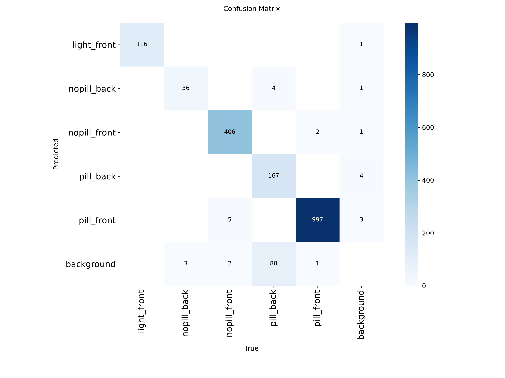
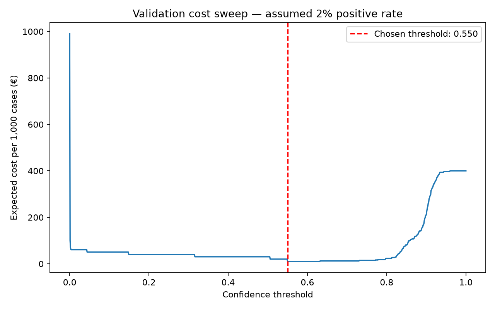

# Assignment 2 Report

- **Name**: Eloy Sánchez
- **Student ID**: 19367
- **Email**: esanchez.ieu2022@student.ie.edu
- **Group**: BBADBA 5B

## Business problem, and the cost of being wrong

I focus on a visual quality-control decision: should a blister pack continue to final packaging, or be held because a pill is missing? An operator checks whether the pockets are filled. My model supports that same completeness decision, assuming every pocket should contain a pill.

I use **one inspection image as one case**. It is positive if any pictured pack has an annotated empty pocket. A hold applies to all packs in that image; I do not charge separately for each missing pill.

A false positive holds a complete case unnecessarily. A false negative releases an incomplete case, making correction more expensive downstream. I assume EUR 1 for an unnecessary hold and EUR 20 for a missed incomplete case. This difference drives my threshold choice. The three outcomes are **pass, fail (hold for correction), or human review**.

The scope is visible pill presence, excluding drug identity, dosage, chemical quality and seal integrity.

## Dataset

I used this public [Roboflow Universe dataset](https://universe.roboflow.com/roboflow100vl-full/pill-j8vgy-o5udx-jbna/dataset/1):

- **Workspace**: `roboflow100vl-full`
- **Project**: `pill-j8vgy-o5udx-jbna`
- **Version**: `1`

Its five detection classes are `pill_front` and `pill_back` for filled pockets, `nopill_front` and `nopill_back` for empty pockets, and `light_front` for the illuminated pack region. I kept the original labels and splits, without forking, collecting or labelling data.

The empty-pocket labels directly support the decision. However, the images do not establish whether pills are missing because of manufacturing errors or previous use. My results evaluate visible completeness, rather than proven factory-defect detection.

## What the dataset's composition implies

I calculated these statistics from the YOLO labels before training:

| Split | Images | With empty pockets | Filled pockets only |
|---|---:|---:|---:|
| Train | 974 | 657 | 317 |
| Validation | 278 | 181 | 97 |
| Test | 140 | 97 | 43 |

| Class | Train instances | Validation instances | Test instances |
|---|---:|---:|---:|
| light_front | 829 | 226 | 116 |
| nopill_back | 265 | 67 | 39 |
| nopill_front | 2,823 | 813 | 413 |
| pill_back | 1,420 | 584 | 251 |
| pill_front | 7,977 | 2,146 | 1,000 |

Filled front-view pockets dominate. The rarest class, `nopill_back`, has only 39 test boxes across seven images. These are not 39 independent inspection cases, so its results are particularly uncertain.

Pockets are small: median test box area is 0.750% of the image for `nopill_front` and 0.457% for `pill_front`. Resizing can remove useful detail. Also, 69.3% of test images contain empty pockets; I do not use that share as a production defect rate.

My split audit found no identical decoded images across splits. A filename check flagged 124 possible shared families, not confirmed duplicates. In the inspected `my_photo-100` family, packs and pill arrangements differed, but the capture setup was similar. This limits conclusions about performance with a new camera or background.

## Finetuning and baselines

I used object detection to locate individual pockets and finetuned the small COCO-pretrained **YOLO11n** model. I evaluated the finetuned model and both baselines on the same 140 test images.

| Training setting | Value |
|---|---|
| Environment | Google Colab, Tesla T4 GPU |
| Software | Ultralytics 8.4.184; PyTorch 2.11.0+cu130 |
| Input size / batch size | 640 pixels / 16 |
| Epochs / patience | 100 completed / 20 |
| Seed / deterministic / workers | 42 / true / 2 |
| Saved best checkpoint | `weights/best.pt` |

Other options used library defaults. Local evaluation used Ultralytics 8.4.173 and CPU PyTorch 2.11.0.

| Model | mAP50 | mAP50–95 |
|---|---:|---:|
| COCO zero-shot, no matching target classes | 0.0000 | 0.0000 |
| Predict nothing | 0.0000 | 0.0000 |
| Finetuned YOLO11n | **0.9541** | **0.6920** |

I ran the original COCO model and saved its raw predictions. COCO has none of the target classes, so I used an empty semantic mapping instead of treating unrelated class IDs as pill detections. Its target results therefore equal the predict-nothing baseline: recall is zero for every class and precision is undefined.

Both baselines release every image: TP = 0, FP = 0, FN = 97 and TN = 43. Their image accuracy is 30.7%, but missing every incomplete case is the relevant failure. Finetuning improves on both, although the vocabulary mismatch makes COCO a weak comparison against a specialised inspection model.

## Per-class evaluation and failure modes

| Class | Precision | Recall | AP50 | AP50–95 |
|---|---:|---:|---:|---:|
| light_front | 0.9878 | 1.0000 | 0.9950 | 0.9844 |
| nopill_back | 0.8426 | 0.9231 | 0.9294 | 0.4843 |
| nopill_front | 0.9923 | 0.9879 | 0.9949 | 0.8228 |
| pill_back | 0.9516 | 0.7056 | 0.8569 | 0.4077 |
| pill_front | 0.9896 | 0.9950 | 0.9943 | 0.7607 |

Precision and recall use Ultralytics' automatic F1 operating point for diagnostic reporting. I selected the business threshold separately on validation data.

Front-view classes and `light_front` support the high overall score; back-view classes are weaker. Each class has equal weight in mAP, regardless of instance count. Detecting the illuminated region well does not itself establish completeness.

This test confusion matrix uses confidence **0.55**. Columns are actual classes and rows are predictions. The background row shows missed objects; the background column shows unmatched predictions.



Of 251 `pill_back` instances, 167 are correctly matched, 80 are missed and four are labelled `nopill_back`. For empty pockets, 36 of 39 back-view instances are correctly matched. Of 413 front-view instances, 406 are correctly matched, five are labelled filled and two are missed.

Object errors and inspection errors differ: a missed pocket does not cause a false release if another empty pocket triggers a hold. However, one incomplete test image passes despite having two annotated empty pockets: its highest empty-pocket score is approximately 0.292, below 0.55. I did not adjust the threshold to fix this test example.

## Cost matrix and operating point

### Assumptions

I assume **10,000 inspection images/day**, a **2% incomplete-case rate**, and labour at **EUR 24/hour**. These are planning assumptions, not measured factory figures or estimates from the dataset.

| Actual condition | Pass | Fail: hold for correction |
|---|---:|---:|
| Complete | TN: EUR 0.00 | FP: EUR 1.00 |
| Incomplete | FN: EUR 20.00 | TP: EUR 0.50 |

An unnecessary hold costs one minute of labour (EUR 0.40) plus EUR 0.60 for handling and disruption. A correct hold costs 30 seconds of labour (EUR 0.20) plus EUR 0.30 for corrective handling/materials. Clearing a false alarm requires more investigation.

An escaped incomplete case costs EUR 4 for replacement/materials, EUR 6 for logistics and EUR 10 for administration (25 minutes of labour). This EUR 20 models expected downstream handling, without valuing possible health consequences. Correct releases have zero incremental cost; costs common to all policies are excluded.

### Threshold selection

My image score is the highest confidence for either empty-pocket class, or zero if neither is detected above the inference floor of 0.001. It is not a calibrated probability of incompleteness.

I swept **1,001 thresholds**, from 0 to 1 in steps of 0.001, on validation data. I reweighted the measured true-positive and false-positive rates to the assumed base rate, p = 0.02:

```text
Cost per 1,000 = 1,000 × {
  p × [TPR × cost_TP + (1 − TPR) × cost_FN]
  + (1 − p) × [FPR × cost_FP + (1 − FPR) × cost_TN]
}
```

The validation minimum was **EUR 10.00/1,000**, with TP = 181, TN = 97 and no errors. Thresholds 0.550–0.631 tied on the grid. My tie rule selected the lowest, **0.55**.



Applying 0.55 unchanged to test data gave:

| Actual condition | Pass | Fail |
|---|---:|---:|
| Complete | TN: 43 | FP: 0 |
| Incomplete | FN: 1 | TP: 96 |

Image-level recall is **96/97 = 98.97%**. Expected cost is `1,000 × 0.02 × [(96/97 × 0.50) + (1/97 × 20)]` = **EUR 14.02/1,000**. This uses class-conditional error rates, rather than the test split's positive share.

### Sensitivity

I changed one assumption at a time, keeping thresholds fixed rather than optimising again on test data.

| Scenario | Model cost/1,000 | Review-all cost/1,000 |
|---|---:|---:|
| Central assumptions | EUR 14.02 | EUR 118.80 |
| Incomplete-case rate: 0.1% | EUR 0.70 | EUR 105.69 |
| Incomplete-case rate: 5% | EUR 35.05 | EUR 139.50 |
| False-negative cost: EUR 100 | EUR 30.52 | EUR 134.80 |
| False-negative cost: EUR 1,000 | EUR 216.08 | EUR 314.80 |
| Review time: 5 seconds | EUR 14.02 | EUR 52.13 |

The model remained cheaper than review-all and release-all in the scenarios examined. Under central assumptions, review-all becomes cheaper at a false-negative cost of roughly EUR 16,959. This crossing ignores staffing limits and depends on a tiny difference between assumed human sensitivity and measured model recall; I would not treat it as a reliable production boundary.

The biggest uncertainty is whether measured error rates transfer to production. Zero false positives among only 43 complete images gives an illustrative one-sided 95% upper bound of 6.73%, assuming independent, representative cases. The audit has not established those assumptions. Raising false-positive costs leaves my sample-based model cost unchanged because this sample contains none, not because future false positives are impossible.

## What a person still has to check

Scores below the lower threshold pass; scores from the lower threshold up to, but excluding, the upper threshold go to review; scores at or above the upper threshold fail. An additional fallback sends images with **no pocket detection at confidence 0.25 or above** to review. Detecting one pocket does not prove that the whole pack is visible.

I assume review takes **15 seconds**, costing **EUR 0.10**, plus the resulting decision cost. Reviewer sensitivity is assumed to be 99% and specificity 99.5%; neither was measured. Difficult review cases could have worse human performance.

One operator provides six productive review hours/day: **1,440 cases**, or **14.4%** of daily volume. I searched threshold pairs on validation in 0.01 steps, also including the binary optimum, subject to this capacity. Ties favour less review, then lower thresholds.

The selected pair is **lower = upper = 0.55**. The confidence review interval is empty, and the pocket fallback triggered on no validation or test images. Validation had no decision errors at this threshold, so paying for review offered no estimated benefit. I kept that result instead of forcing a review band.

| Policy | Cost/1,000 cases | Reviews/day | Review hours/day | Review staff needed* |
|---|---:|---:|---:|---:|
| Release everything | EUR 400.00 | 0 | 0 | 0 |
| Human checks everything | EUR 118.80 | 10,000 | 41.67 | 7 |
| Model alone | EUR 14.02 | 0 | 0 | 0 |
| Model with selected review policy | EUR 14.02 | 0 | 0 | 0 |

*Dedicated staff, rounded up from six productive hours/person. Review-all needs 6.94 full-time equivalents, exceeding the available operator. Corrective handling is priced separately from review hours.*

Human-policy costs are expectations under my assumptions; model routing comes from test predictions. The selected policy has **0% review and zero dedicated review staff** on these data. That does not establish zero production demand or account for peak arrivals.

My prototype choice is 0.55/0.55 with the pocket fallback. I would use a supervised pilot before permitting autonomous production release.

### Dashboard and execution

The Gradio app loads `weights/best.pt` and saved outputs without training. It supports image uploads, adjustable thresholds, updated confusion matrices, expected cost/1,000 and review workload. It also shows the validation cost curve with the selected threshold, and per-class results. Slider experiments do not overwrite the selected policy.

```bash
uv run python main.py train
uv run python main.py app
uv run python check.py
```

`train.py` connects downloading, inspection, finetuning, evaluation and cost analysis. The app startup check passed locally. Training and analysis stages were run during development; that check does not itself verify a complete training run.

## Limitations & next steps

- **Capture conditions:** the images do not establish manufacturing defects or performance on an industrial line. I would test the fixed policy on representative line images before deployment.
- **Back-view evidence:** `nopill_back` has only seven test images, while `pill_back` has the weakest recall. A larger independent evaluation would help establish whether this persists. Higher-resolution experiments would be selected using validation data.
- **Assumed economics and human accuracy:** I would measure review times, reviewer errors, correction costs and defect prevalence during a pilot, then reassess the policy.
- **Limited fallback:** one detected pocket does not establish full visibility or image suitability. The missed incomplete case remains a reason for supervised validation despite strong overall AP.

## Generative AI use disclosure

I used ChatGPT for dataset investigation, code assistance, explanations of evaluation and cost calculations, debugging, and help drafting and editing this report. Its contribution included suggested assumptions and interpretations, as well as wording. I ran the training and evaluation code and tested the dashboard; metrics come from saved outputs. Cost and human-performance figures are assumptions, not measurements.