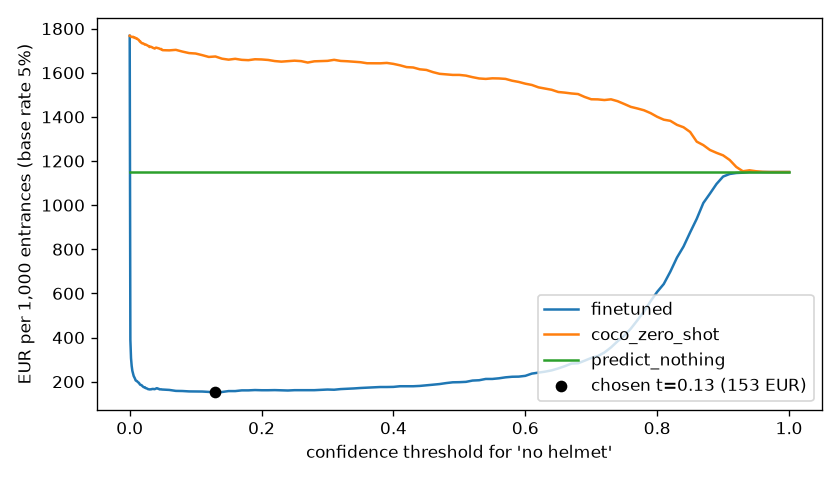

# Assignment 2 Report

- **Name**: Gonzalo Ruiz Feliu
- **Student ID**: 19100
- **Email**: gruiz.ieu2022@student.ie.edu
- **Group**: BBADBA 5B

## Business problem, and the cost of being wrong

**The decision.** A camera at the entrance of a construction site checks every
person who walks through the gate. The model answers one question per person:
*is this person not wearing a hard hat?* The gate guard (the site's safety
officer, *recurso preventivo*) acts on it: either the person walks in, or the
guard stops them and sends them to get a helmet. One **case** is one person
entering. The **positive class is "head" (no helmet)**.

I chose the entrance over cameras watching the work area because a case is
then well defined (one person, one decision), the daily volume is simply the
number of entrances, and the three outcomes (let in / stop / guard checks the
photo) map directly onto what a guard already does.

**What each mistake costs** (per case, in EUR):

| Outcome | What happens | Cost |
|---|---|---|
| **False negative**: no helmet, let in | The company is exposed to a labour-inspection fine and the worker to a head injury | **23.00** |
| **False positive**: has a helmet, stopped | Worker and guard each lose ~2 minutes | **1.77** |
| **True positive**: no helmet, stopped | Same 2 + 2 minutes, but the risk is avoided | **1.77** |
| **True negative**: has a helmet, let in | Nothing | **0** |

- **FP and TP** = 2 people × 2 min × 26.51 EUR/h (INE, average effective
  hourly labour cost in Spain, Q4 2025) = 1.77 EUR.
- **FN** = expected fine + expected accident cost:
  - P(inspection on a given day) = 1/250, roughly one visit a year to a site,
    × 5,000 EUR (a serious health-and-safety infringement under LISOS
    art. 40.2, minimum grade, 2,451–9,830 EUR) = **20 EUR**;
  - P(head injury on a day without helmet) = 1/5,000, an order-of-magnitude
    assumption, × 15,000 EUR (INSST/Ministry estimate of ~10,600 EUR per
    workplace accident with sick leave, from 2008, inflated to today) = **3 EUR**.

**The asymmetry.** A missed worker without a helmet costs about **13 times**
more than a needless stop. That is why the threshold has to be low: we would
rather stop someone by mistake than let an unprotected worker in. Everything
below, from the threshold to the share sent to the guard and the metric I care
about (recall on "head"), follows from this ratio.

**Production setting.** Base rate: **5%** of entrances without a helmet. Most
workers comply at a controlled gate, but some forget. Volume: **200 entrances a
day** (100 workers × 2, morning and after lunch).

## Dataset

**Hard Hat Workers**, Roboflow Universe: workspace `joseph-nelson`, project
`hard-hat-workers`, **version 5** (`raw_HeadHelmetClasses`).
<https://universe.roboflow.com/joseph-nelson/hard-hat-workers/dataset/5>
Public domain (CC0). Originally from Northeastern University (China).

- **One image** is a photo of one or more people at or around a work site.
- **Classes**: `head` (a head without a helmet) and `helmet` (a head with one).
  Detection with two classes; the background is the free negative class.
- **Why version 5**: it has the two classes the decision needs, no
  augmentation (versions 11–13 triple the training set with rotated and
  brightened copies, which YOLO already does on the fly), and a fixed
  70/20/10 train/valid/test split. Version 10 also has a `person` class, but
  it has only 615 labels, applied in only some images, so it would only add an
  unreliable number.
- **Why it serves the problem**: the gate decision is exactly "is there a
  head without a helmet?", and this dataset labels precisely that, at the head
  level, in real site photos.

## What the dataset's composition implies

| Split | Images | `head` (no helmet) | `helmet` | Images with ≥1 `head` |
|---|---|---|---|---|
| Train | 4,916 | 4,612 | 13,919 | 18.5% |
| Valid | 1,413 | 1,339 | 3,913 | 18.1% |
| Test | 706 | **726** | **1,915** | 19.8% |

- **Object size**: a head's box side is a median **~8% of the image side**
  (10th–90th percentile 5–14%); only ~1% are tiny (<3% of the side). Images
  are small, around 500 × 333 px. Median 3 labelled heads per image, up to 35.

**What this implies:**

1. **Enough data to trust the per-class numbers.** 726 heads without helmet
   in test means the `head` recall moves by about 0.14 percentage
   points per misclassified head, so it is not driven by a handful of cases. The class mix
   is almost identical across the three splits, which is consistent with a
   random split: test is not skewed towards easier or harder classes than
   training.
2. **The test split does not look like my gate.** In a random sample of
   the test images that contain only heads without helmets, most are
   **press photos**: officials in suits
   visiting a site, in groups, often far away. My camera would see one person
   walking towards it, close up. The test numbers measure the model on a
   harder and different scene, so they will **not transfer exactly** to the
   gate. That would need a pilot with real gate footage.
3. **The test base rate is not mine.** In test, 726 of 2,641 people (27%) have
   no helmet; at my gate it is 5%. So I **never compute cost from the test
   counts directly**. I take the true-positive and false-positive rates (which
   do not depend on the mix) and re-weight them by the 5% base rate.
4. **Low resolution.** A real camera would give sharper heads, which should
   help, but I cannot measure that with this data.

## Finetuning and baselines

**Model and task.** Object detection with **`yolo11n`**, finetuned from its
COCO-pretrained checkpoint. Detection rather than classification because one
image can contain several people and the decision is about *each* head. The
nano model trains fast and the task (large-ish heads, two visually distinct
classes) does not need a bigger one.

**Training.** On my MacBook Pro (Apple M2 Pro, 16 GB) using the Apple GPU
(`mps`): 30 epochs (early-stopping patience 10, not triggered), image size
512 (images are ~500 px wide, so 640 would only upscale them), batch 16,
seed 0, Ultralytics defaults otherwise (AdamW chosen automatically, built-in
augmentation). It took **1.6 hours**; the best epoch on validation was 29.
`uv run python main.py train` runs the whole pipeline: download, training,
evaluation, cost sweep, review band and outputs for the dashboard.

**Results on the same test split (706 images):**

| Model | mAP50 | mAP50-95 | Cost per 1,000 entrances (best threshold) |
|---|---|---|---|
| **Finetuned yolo11n** | **0.968** | **0.673** | **153 EUR** |
| COCO yolo11n zero-shot | 0.005 | 0.002 | 1,150 EUR |
| Trivial: predict nothing (= let everyone in) | 0 | 0 | 1,150 EUR |

- **COCO zero-shot**: COCO has a `person` class but nothing about helmets. I
  scored its `person` boxes as "head". It finds people (it flags 74% of people
  without a helmet at confidence 0.5), but it flags 73% of people *with* one
  too: it cannot tell them apart. Its best threshold is therefore to stop
  nobody, which makes it exactly as good as doing nothing.
- **Predict nothing** never stops anyone: 50 unprotected workers per 1,000
  entrances get in, at 23 EUR each.
- **The gap** is as large as expected. The task depends entirely on a concept
  ("helmet") that the pretrained model never learned, so finetuning is what
  makes the model usable at all.

## Per-class evaluation and failure modes

**Per class, test split** (precision and recall at the confidence that
maximises F1, as Ultralytics reports them):

| Class | Precision | Recall | AP50 | AP50-95 |
|---|---|---|---|---|
| **head (positive, no helmet)** | 0.932 | 0.931 | 0.961 | 0.669 |
| helmet | 0.947 | 0.937 | 0.976 | 0.677 |

**Confusion matrix** (detection, confidence 0.25; columns are the truth):

| Predicted ↓ / True → | head | helmet | background |
|---|---|---|---|
| head | **685** | 3 | 77 |
| helmet | 18 | **1,834** | 168 |
| background (missed) | 23 | 78 | – |

- **The headline number is carried by `helmet`** (AP50 0.976): it is the
  majority class (73% of labels) and helmets are visually distinctive.
  **`head` is the weaker class** (AP50 0.961, mAP50-95 0.669), and it is the
  one my costs depend on.
- **Of 726 heads without a helmet, 41 are lost at confidence 0.25**: 18 are
  mistaken for a helmet and 23 are not detected at all. These are the
  expensive errors.
- **77 false "head" boxes on background** are false alarms that would stop
  someone at the gate.
- **Where it breaks**, from looking at the lowest-scored heads and the
  highest-scored false alarms in test (a visual check, not a measurement):
  - **Misses**: heads cut off at the image border, partly hidden behind
    another person, seen from behind or lying down, and a bare head standing
    in a group where everyone else wears a helmet.
  - **False alarms**: people **holding a helmet in their hand** instead of
    wearing it, and blurred faces in the foreground.

**From boxes to cases.** The decision is made per person, so each test person
(each labelled head or helmet, 2,641 in total) gets a "no helmet" score: the
highest confidence among the `head` boxes attributed to them. Each predicted
box is attributed to the person it overlaps most, or to the nearest person if
it overlaps nobody. This matters because at the gate there is only one person
in frame, so a false "head" box drawn on the background would stop that
person. Ignoring such boxes would make the model look cheaper than it is.

## Cost matrix and operating point

The costs and base rate are those in the first section: FN 23.00 EUR,
FP 1.77 EUR, TP 1.77 EUR, TN 0, base rate 5%.

**Expected cost per case**, at a threshold *t* (stop if score ≥ *t*):

> cost = 5% × [TPR × 1.77 + (1 − TPR) × 23.00] + 95% × [FPR × 1.77]

**The sweep.** I computed this for every threshold from 0 to 1 (steps of
0.001 below 0.05, 0.01 above) and plotted cost per 1,000 entrances against the
threshold (`outputs/cost_curve.png`, also in the dashboard).

**Operating point, model deciding alone: threshold 0.13**, at **153 EUR per
1,000 entrances**. At that threshold the model catches 96.3% of people
without a helmet (TPR) and wrongly stops 1.5% of people with one (FPR). In
test, that means 27 of 726 unprotected people missed and 29 of 1,915
protected people stopped. The threshold is low, as the 13:1 cost asymmetry
predicted.

**How the answer changes if my assumptions are wrong:**

| Scenario | FN cost | Best threshold | Cost / 1,000 |
|---|---|---|---|
| **Baseline** | 23.0 | **0.13** | 153 |
| Base rate 2% | 23.0 | 0.24 | 75 |
| Base rate 10% | 23.0 | 0.03 | 275 |
| P(inspection) × 0.5 | 13.0 | 0.24 | 135 |
| P(inspection) × 2 | 43.0 | 0.03 | 188 |
| P(accident) × 0.5 | 21.5 | 0.13 | 150 |
| P(accident) × 2 | 26.0 | 0.13 | 159 |

**The assumption that matters most is P(inspection)**, because the expected
fine (20 EUR) is most of the FN cost. If inspections were half as likely, the
threshold would move from 0.13 to 0.24. If they were twice as likely, it would
move to 0.03. The accident probability barely moves it. Whatever the scenario,
the model beats doing nothing (1,150 EUR) by a wide margin. That conclusion
only flips if the FN cost falls to about 1.8 EUR, the cost of a stop, which
no plausible fine or accident figure gives.

## What a person still has to check

**Three outcomes, two thresholds:**

- score **≥ 0.85** → **stop** automatically;
- score **between 0.004 and 0.85** → **the gate guard looks at the photo**
  and decides;
- score **< 0.004** → **let in**.

**How I chose them.** I searched every pair (lower, upper) of thresholds for
the lowest expected cost, keeping only pairs whose review load fits the guard
at the busiest moment. A review takes **15 seconds** of the guard's time,
0.11 EUR at the same hourly cost. I assume the guard is always right: a
reviewed person without a helmet is stopped (0.11 + 1.77 EUR), and a reviewed
person with one is let in (0.11 EUR). The binding constraint is the **morning
peak**: about 100 people arrive in 15 minutes, so the guard can review at
most 15 × 60 / 15 = 60 people, i.e. 60% of them.

**The chosen band sends 11.7% of entrances to the guard:**

- **23 reviews a day**, about **6 minutes** of the guard's day;
- at the morning peak, about 12 reviews, **2.9 minutes** out of the 15.

**This is realistic**: the guard is already at the gate, so no one has to be
hired, and the peak load uses a fifth of the available window. In test, of
726 people without a helmet, 187 are stopped automatically, 526 go to the
guard (and are caught) and only 13 walk in. Of 1,915 with a helmet, none is
stopped automatically and 162 go to the guard.

**Why the lower threshold is so low.** Reviewing a doubtful case costs 0.11
EUR, and letting an unprotected worker in costs 23 EUR, so almost any doubt is
worth a look. The cost is flat around this choice: a lower threshold of 0.01
costs 121 EUR (8.8% reviewed) and 0.02 costs 121 EUR (7.3% reviewed). So the
decision does not hinge on the exact number. If the guard had less time, I
would raise it to 0.02 for 1 EUR more per 1,000 entrances.

**Priced against the alternatives** (per 1,000 entrances, base rate 5%):

| Option | Cost | Unprotected workers let in | Sent to guard | Guard time at peak |
|---|---|---|---|---|
| Do nothing | 1,150 EUR | 50 | 0% | – |
| Guard checks everyone | 199 EUR | 0 | 100% | 25 min ✗ (only 15 available) |
| Model alone (t = 0.13) | 153 EUR | 1.9 | 0% | – |
| **Model + guard review (0.004 / 0.85)** | **120 EUR** | **0.9** | **11.7%** | **2.9 min ✓** |

The combined design is the cheapest and lets in the fewest unprotected
workers. Having the guard check everyone would catch everybody, but it does
not fit the morning peak (25 minutes of checking for a 15-minute arrival
window means a queue at the gate) and still costs more. The model alone is
cheaper than checking everyone but lets in twice as many unprotected workers
as the combined design.

## Limitations & next steps

- **The test images are not gate images** (press photos, groups, distance,
  low resolution). → Run a two-week pilot at a real gate, label a few hundred
  frames, and re-measure TPR/FPR and the score distribution before trusting
  the thresholds.
- **The base rate (5%) and P(inspection) are assumptions.** → Measure the base
  rate during the pilot (the guard's reviews give it for free), and ask the
  company's prevention service for its real inspection history. The
  sensitivity table shows where the threshold moves if they differ.
- **The guard is assumed always right**, and reviews take a fixed 15 s. →
  During the pilot, have a second person re-check a sample of the guard's
  decisions, and time the reviews.
- **Cost figures are national averages and old estimates** (hourly cost not
  specific to construction; 2008 accident cost inflated). → Replace them with
  the company's own payroll and accident-cost data.
- **Scores are not calibrated probabilities**, and the best thresholds sit
  close to zero, where small shifts in the score distribution matter. →
  Re-sweep the thresholds on pilot data, and re-sweep whenever the model is
  retrained.
- **"Helmet" means a helmet on the head**: someone holding a helmet, or
  wearing an unfastened one, is a known confusion, and the model checks no
  other protective equipment (vest, boots). → Add labelled examples of held
  helmets, and extend the classes if the site needs more PPE.
- **Multi-person test images** required attributing boxes to the nearest
  person, which only approximates the single-person gate. → Evaluate on
  single-person gate frames from the pilot.
- **Filming workers is personal-data processing** (GDPR / LOPDGDD art. 89):
  workers must be informed, and images should only be kept as long as the
  check needs. → Involve the company's data-protection officer before deployment.

## Generative AI use disclosure

I used **Claude Code (Anthropic, model Claude Opus 5.5)** throughout, for doing
most of the difficult code step by step in phases and asking it to explain each step so I could defend it.

- **Code**: Claude helped me write `train.py`, `costing.py` and `app.py`, and helped me run the training, evaluation, `check.py` and a browser test of the dashboard on my
  machine.
- **Research**: ChatGPT helped me search for some sources behind the cost
  figures, and compared candidate datasets on Roboflow Universe.
- **Decisions**: for every important decision I did most of the job. Claude helped me
  giving me some recomendations but it was me who decided.
- **This report**: written by me and formated and improved with the help of ChatGPT.
