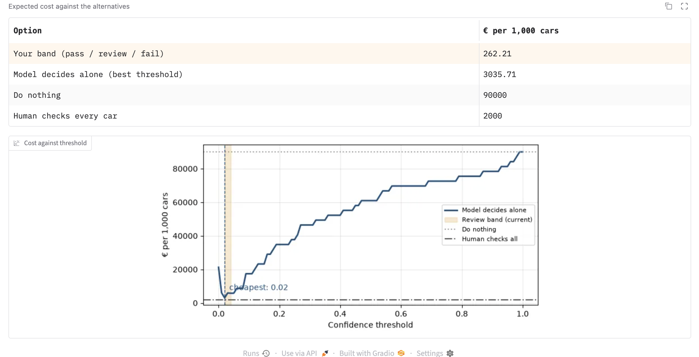

# Assignment 2 Report

- **Name**: Antonio Vicenzo Argenta Medina
- **Student ID**: 20498
- **Email**: aargenta.ieu2022@student.ie.edu
- **Group**: BBADBA 5B

## Business problem, and the cost of being wrong

**Decision:** before an insurer issues a comprehensive ("todo riesgo") car policy, the customer uploads photos of the car. The model decides whether the car already has visible damage.
**Who acts:** an underwriter. Cars marked "fail" have their damage recorded and excluded from cover, cars marked "pass" get the policy issued as is, and cars in between go to the underwriter for a manual check.
**Positive class:** the car has pre-existing damage.

| Error | What happens | Cost |
|---|---|---|
| False negative | Existing damage is not recorded. The customer can later claim it as a new incident and the insurer pays the repair. | €600 |
| False positive | A clean car is flagged. The customer is asked to re-shoot photos or book an inspection, and some abandon the purchase. | €25 |

A miss costs the insurer a repair bill: unrecorded damage gets claimed later as new. A false flag only costs staff time and the odd lost customer. At €600 vs €25, one miss costs as much as 24 false alarms, so it is better to over-flag, and the threshold sits low.

## Dataset

- **Roboflow Universe**: workspace `celebalworkspace`, project `car-damage-detection-dy5hu`, version 2
- **Link**: https://universe.roboflow.com/celebalworkspace/car-damage-detection-dy5hu/dataset/2
- **Task**: object detection, 7 classes: Broken-Glass, Broken-hood, Broken-light, Dent, Scratch, Undamaged, and `15` (a stray label with 1 instance)
- **One image** is one photo of a car or part of a car. Clean cars carry an `Undamaged` box instead of being left empty.
- **Per-car rule**: a car counts as damaged if it has at least one box of a damage class. `Undamaged` is not a damage class.
- **Datasets rejected**: `project-p5nyc/car-damages-v3gyz` (2,324 images, has a "No Damage" class) is a semantic segmentation project and cannot be trained as YOLO detection. The larger detection datasets found list no undamaged or no-damage class, so false positives could not be measured on them.

It is one of the few detection datasets with both damaged and clean cars. The larger ones are either segmentation or list no undamaged class, and without clean cars false positives (half the cost model) can’t be measured. Real pre-inspection photos are phone shots of the whole car in streets and driveways with varied light.

## What the dataset's composition implies

| Split | Images | Damaged cars | Clean cars | Broken-Glass | Broken-hood | Broken-light | Dent | Scratch | Undamaged | `15` | Median box (% of image) | Boxes under 1% of image |
|---|---|---|---|---|---|---|---|---|---|---|---|---|
| train | 260 | 215 | 45 | 55 | 39 | 44 | 58 | 100 | 45 | 1 | 11.8% | 10.5% |
| valid | 72 | 58 | 14 | 10 | 12 | 13 | 8 | 34 | 14 | 0 | 11.4% | 14.3% |
| test | 38 | 31 | 7 | 7 | 2 | 10 | 17 | 12 | 7 | 0 | 7.7% | 16.4% |

Statistical precision of the test split:

| Quantity | Observed on test | 95% interval (Wilson) |
|---|---|---|
| False-positive rate (clean cars flagged at t = 0.02) | 1 of 7 = 14% | 3% to 51% |
| False-negative rate (damaged cars missed at t = 0.02) | 0 of 31 = 0% | 0% to 11% |

The test split is 82% damaged cars. The cost calculation does not use that mix: it measures the model's behaviour on damaged and clean cars separately and re-weights both by the assumed production base rate of 15%.

Classes with fewer than about 10 test instances are anecdotal. For Broken-hood (2), one detection moves recall by 50 points; for Broken-Glass (7), by 14. The false-positive rate rests on 7 clean cars (interval 3–51%), and 0 of 31 misses still allows up to 11%. Test boxes are smaller than training boxes (median 7.7% vs 11.8%), so the test is harder for dents and scratches. These results don’t show the model works on real customer photos, or that a flag means it found the damage.

## Finetuning and baselines

- **Model**: `yolo11n`, object detection, finetuned from COCO-pretrained weights
- **Training**: MacBook with Apple M1, on CPU. Image size 640, batch 16, maximum 50 epochs, early stopping with patience 15. Training was interrupted once and resumed from the last checkpoint. It stopped early and the best epoch was 27.
- **Baselines**: COCO-pretrained `yolo11n` used zero-shot, scored by its highest confidence on any detection (COCO has no damage class, so its detection mAP on these classes is 0 by construction), and a trivial model that never flags damage.

All three evaluated on the same 38 test cars, each at its own cheapest threshold:

| Model | mAP50 | Car-level AUC | Cost per car | Cost per 1,000 cars |
|---|---|---|---|---|
| Finetuned YOLO11n | 0.450 | 0.995 | €3.04 (t = 0.02) | €3,036 |
| COCO zero-shot | 0.000 | 0.194 | €21.25 (flags every car) | €21,250 |
| Never flag damage | 0.000 | 0.500 | €90.00 | €90,000 |

The gap is bigger than expected for a nano model on 260 images, which is a warning sign. COCO has no damage class, so its score is mostly “how much this looks like a car”. Whole-car clean shots score high and damaged close-ups score low, which is why its AUC is 0.194. If framing alone separates the classes, the finetuned model may be using the same shortcut. An AUC of 0.995 means one misordered pair out of 217, and one more badly scored clean car would cut it by about 0.14. I don’t trust it as a real-world estimate.

## Per-class evaluation and failure modes

Box-level results on the test split:

| Class | Test instances | Precision | Recall | AP50 | AP50-95 |
|---|---|---|---|---|---|
| Broken-Glass | 7 | 0.787 | 0.857 | 0.837 | 0.544 |
| Broken-hood | 2 | 1.000 | 0.000 | 0.011 | 0.009 |
| Broken-light | 10 | 0.476 | 0.800 | 0.602 | 0.314 |
| Dent | 17 | 0.221 | 0.059 | 0.082 | 0.017 |
| Scratch | 12 | 0.453 | 0.333 | 0.172 | 0.083 |
| Undamaged | 7 | 0.896 | 1.000 | 0.995 | 0.914 |
| **All classes** | | 0.639 | 0.508 | **0.450** | 0.314 |
| **Damage classes only** | | | | **0.341** | |

Confusion matrix at box level, confidence 0.25 (rows are predictions, columns are ground truth; class `15` has no test instances and is omitted):

| Predicted / True | Broken-Glass | Broken-hood | Broken-light | Dent | Scratch | Undamaged | Background |
|---|---|---|---|---|---|---|---|
| Broken-Glass | 6 | 0 | 0 | 0 | 0 | 0 | 1 |
| Broken-hood | 0 | 0 | 0 | 0 | 0 | 0 | 0 |
| Broken-light | 0 | 0 | 9 | 1 | 0 | 0 | 6 |
| Dent | 0 | 0 | 0 | 0 | 0 | 0 | 3 |
| Scratch | 0 | 0 | 0 | 0 | 4 | 0 | 4 |
| Undamaged | 0 | 0 | 0 | 0 | 0 | 7 | 0 |
| Background (missed) | 1 | 2 | 1 | 16 | 8 | 0 | |

At the box level the model finds 0 of 17 dents and 4 of 12 scratches. At the car level, every damaged test car is still flagged at threshold 0.02.

Undamaged (0.995) and Broken-Glass (0.837) carry the headline mAP. Without Undamaged, mAP50 on damage classes is 0.341. Dents and scratches are low-contrast, small and loosely annotated, and the model found 0 of 17 dents. Cars still get flagged because the car score is the highest box anywhere in the image, so any weak box clears 0.02. A real car with just one small dent probably passes, and dents and scratches are the most common pre-existing damage. Broken-hood’s precision of 1.0 is 0/0: the model made no Broken-hood predictions at all.

## Cost matrix and operating point

| Item | Value | Justification |
|---|---|---|
| False negative | €600 | Average bodywork repair in Spain is about €1,500 ([Autofácil](https://www.autofacil.es/reparaciones-mas-caras-talleres/): average job ≈ €1,517). Assume 40% of unrecorded damage gets claimed later. The 40% is my least certain guess. |
| False positive | €25 | About €5 of staff time plus 4% of flagged customers walking away × €500 of lost customer value (comprehensive cover with an excess averages ~€424/year in Madrid, per [Rastreator](https://www.rastreator.com/noticias/seguros-de-coche/precio-seguro-coche-provincias), and a customer typically renews for more than one year). |
| True positive, true negative | €0 | Correct outcomes, the baseline the other costs are measured against. |
| One human review | €2 | 3 min × €40/h loaded cost. |
| Base rate | 15% | Assumption. Spain’s fleet is old (14.6 years on average), but buyers of comprehensive cover skew to newer cars. |

Cost against threshold when the model decides alone (per 1,000 cars):

| Threshold | 0.00 | 0.02 | 0.05 | 0.10 | 0.25 | 0.50 | 1.00 |
|---|---|---|---|---|---|---|---|
| Cost | €21,250 | **€3,036** | €5,806 | €17,419 | €37,742 | €60,968 | €90,000 |

On the test cars, clean cars score at most 0.034 and damaged cars at least 0.025. At 0.02 every damaged car is flagged and one clean car is wrongly flagged. At 0.05 no clean car is flagged but 2 damaged cars are missed.

Sensitivity of the comparison between the model alone (t = 0.02) and a person checking every car:

| Base rate | Model alone | Model + review band | Person checks every car | Do nothing |
|---|---|---|---|---|
| 5% | €3.39 | €0.28 | €2.00 | €30.00 |
| 15% (assumed) | €3.04 | €0.26 | €2.00 | €90.00 |
| 30% | €2.50 | €0.24 | €2.00 | €180.00 |
| 44% | €2.00 | €0.22 | €2.00 | €264.00 |

At the assumed 15% base rate, the model alone only beats a person checking every car if a false positive costs less than about €16.50. The model alone becomes cheaper than checking everything only once the base rate exceeds about 44%.

Scores are squeezed near zero (clean at most 0.034, damaged at least 0.025), and the cost ratio favours flagging, so the cheapest threshold is 0.02. I wouldn’t ship it alone: it rests on one clean car, and at a 15% base rate the model alone (€3.04) costs more than checking every car (€2.00). The miss rate matters most. Each 1% of damaged cars missed adds €0.90 per car, so above about a 1.9% miss rate even model plus band costs more than full review. One miss out of 31 would flip the decision.

## What a person still has to check

Cheapest band from the sweep: pass below 0.02, review from 0.02 to 0.04, fail at 0.04 and above. The band I recommend for launch is wider (0.01 to 0.25); see the end of this section.

Test cars in each outcome:

| Actual | Fail | Review | Pass |
|---|---|---|---|
| Damaged (31) | 29 | 2 | 0 |
| Clean (7) | 0 | 1 | 6 |

Per 1,000 cars at a 15% base rate:

| Actual | Fail | Review | Pass |
|---|---|---|---|
| Damaged (150) | 140.3 | 9.7 | 0 |
| Clean (850) | 0 | 121.4 | 728.6 |

Workload: 13.1% of cars go to review, about 79 of 600 cars a day. At 3 minutes each that is about 236 minutes a day, or 0.56 reviewers at 7 productive hours each. Three reviewers are available.

| Option | Cost per 1,000 cars | Reviewers needed |
|---|---|---|
| Do nothing (issue every policy) | €90,000 | 0 |
| Person checks every car | €2,000 | 4.3 |
| Model decides alone (t = 0.02) | €3,036 | 0 |
| **Model + review band (0.02 to 0.04)** | **€262** | **0.56** |

Wider review bands, for a more cautious launch:

| Band | Cost per 1,000 cars | Share reviewed | Cars per day | Reviewers needed |
|---|---|---|---|---|
| 0.02 to 0.04 (cheapest) | €262 | 13.1% | 79 | 0.56 |
| 0.01 to 0.10 | €544 | 27.2% | 163 | 1.17 |
| 0.01 to 0.25 | €612 | 30.6% | 183 | 1.31 |
| 0.005 to 0.50 | €1,175 | 58.7% | 352 | 2.52 |

All of these assume the reviewer always decides correctly.

Capacity isn’t the issue, since every band fits within 3 reviewers. I’d launch with 0.01–0.25: €350 more per 1,000 cars, which pays for itself if it catches one miss per roughly 1,700 cars, and it needs only 1.31 reviewers. Assuming perfect reviewers flatters every review option, because real reviewers also miss small dents. Recommendation: pilot with the 0.01–0.25 band plus a 5% audit of passed cars. Narrow the band if the measured miss rate stays under 2%; otherwise review everything.

## Limitations and next steps

- Photo-style shortcut. Test on 500+ real customer submissions, including whole-car shots of damaged cars.
- Dent and scratch recall. Add dent and scratch annotations from damaged-only datasets, train at image size 1024, and report recall on dent-only cars.
- 7 clean test cars. Get 100+ clean test cars and use cross-validation.

- Also: measure reviewer accuracy with double review, drop class 15, and retrain yolo11s on a GPU.

## Sources

- Autofácil, average bodywork repair cost in Spain: https://www.autofacil.es/reparaciones-mas-caras-talleres/
- Rastreator, comprehensive car insurance premiums by province: https://www.rastreator.com/noticias/seguros-de-coche/precio-seguro-coche-provincias
- ANFAC Annual Report 2025 on vehicle fleet age, reported by Motor16: https://www.motor16.com/mercado/edad-media-coches-espana-2025/
- Roboflow Universe dataset: https://universe.roboflow.com/celebalworkspace/car-damage-detection-dy5hu/dataset/2

## Generative AI use disclosure

I used Claude as a coding and tutoring assistant. It helped me write the code in `train.py` and `app.py` based on the class codes I gave it, explained the concepts as I worked, suggested candidate datasets for my wished theme, and formatted the result tables in this report from my pipeline's `results.json`. The choice of problem and framing, the cost figures and base rate I used, the thresholds, the review, and the analysis and conclusions in this report are my own.
